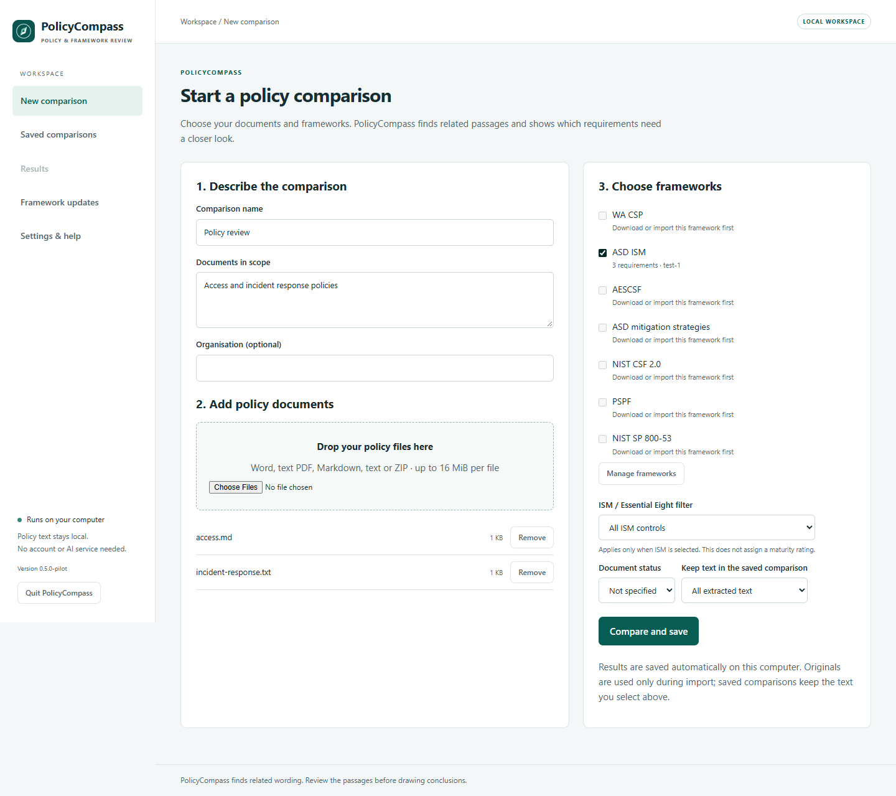
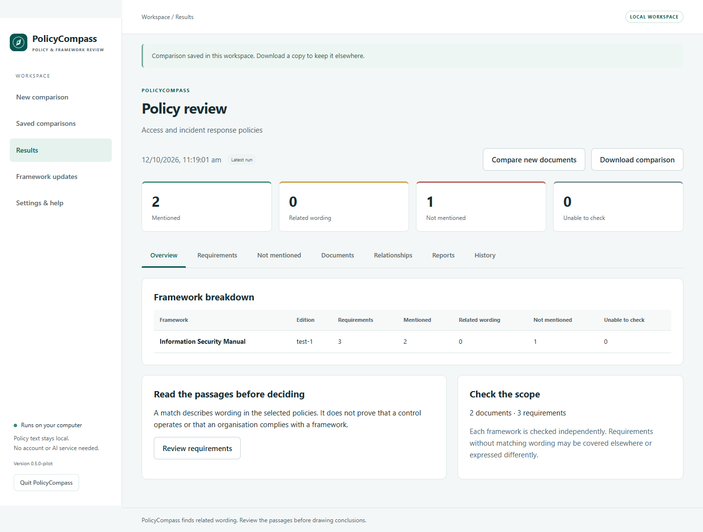

# Use PolicyCompass in your browser

Install the Windows release and open the **PolicyCompass** shortcut. It starts
the local application and opens your default browser. Opening the shortcut again
reuses the running application.

The portable release works the same way: extract its entire ZIP and open
`PolicyCompass.exe`. Both editions use the same local user data folders.

## First comparison

1. Open **Framework updates**, select the frameworks you need and choose
   **Download selected frameworks**. Internet access is needed for this step.
2. For AESCSF, follow the AEMO link, download the Core workbook and import it.
3. Open **New comparison**. Give it a name and describe the documents in scope.
4. Select documents or drop them onto the file area. Supported files are DOCX,
   text PDF, Markdown, TXT and ZIP archives containing these formats.
5. Select frameworks and choose **Compare and save**.

Files are limited to 16 MiB each. Up to 250 documents can be compared, including
documents inside ZIP files. See [file limits](COMMANDS.md#file-limits).

The app remembers framework choices, organisation name and text retention settings.
You can change their defaults in **Settings & help**. An ISM maturity filter applies
only when ISM is selected; it does not assign an Essential Eight maturity rating.

## Review the results

**Overview** shows a count for each status and framework. **Requirements** lets you
search and filter the full list. Select a reference to read the framework wording
and matching policy passages. Highlighted words explain the match; qualifications
and negative wording still need review.

**Not mentioned** starts with requirements for which no related wording was found.
**Documents** shows extraction status and the text retained in the comparison.
**Relationships** shows available framework links; a link does not count as evidence.

Read [how matching works](MATCHING.md) before interpreting a result as a policy gap.

These screenshots use temporary test documents and a synthetic catalogue to show
the interface. Those inputs are not included in the release.

## Save, reopen and export

Completed comparisons are saved automatically on this computer. Open **Saved
comparisons** to find them. **Download comparison** creates a `.policycompass` copy
with all saved runs. Import that file to move or restore a comparison without
changing the original.

To compare revised documents, open a comparison and choose **Compare new documents**.
The new run is added to its history. **History** lets you open earlier runs, which
retain their original framework editions and matching results.

In **Reports**, choose the frameworks, file format and whether to include policy
passages. Reports use the run currently open. Your browser's download settings
control where exported files go.

## Where files are kept

| Content | Default location |
|---|---|
| Comparisons and settings | `%LOCALAPPDATA%\PolicyCompass\browser` |
| Downloaded frameworks | `%LOCALAPPDATA%\PolicyCompass\frameworks` |
| Installed application | `%LOCALAPPDATA%\Programs\PolicyCompass` |

Policy documents are sent only to the local application on your computer.
Temporary copies are deleted after comparison or import. Unused uploads are
removed when the application exits, and incomplete uploads from an earlier session
are removed on its next launch. Saved comparisons keep the extracted text you chose
to retain. Original file hash checks may report the temporary source as unavailable;
the retained passages and their hashes remain in the saved file.

Uninstalling removes the application, while leaving your comparisons, settings and
frameworks in place. Download comparison files to back them up. The application
does not encrypt these files.

Developers can set `POLICYCOMPASS_HOME` to use another local browser workspace.
Framework cache and library settings are described in [configuration](MIGRATION.md).

## Closing and troubleshooting

Use **Quit PolicyCompass** to stop the local application. Closing all its browser
tabs leaves it available for ten minutes, then it stops once active work finishes.
A cancelled framework update keeps any frameworks that finished before cancellation.
An active network request may need a moment to stop.

If the browser says the session has ended, use the application shortcut again.
The address changes between launches and should not be bookmarked. If a framework
download fails, the app keeps its previous version and shows the publisher link.
You can download the file yourself and use **Import framework file**.

If the browser does not open, check your Windows default browser setting and open
the shortcut again. If a document cannot be read, inspect its status in **Documents**.
Scanned PDFs need text recognition before import.

## Local service

The service listens only on `127.0.0.1`, using an automatically selected port.
Each launch has a random session credential. API requests check that credential,
the requested host and the browser origin. Other devices cannot use this address.
The interface and its assets are included in the application; no external scripts,
fonts or hosted services are needed for comparisons.
