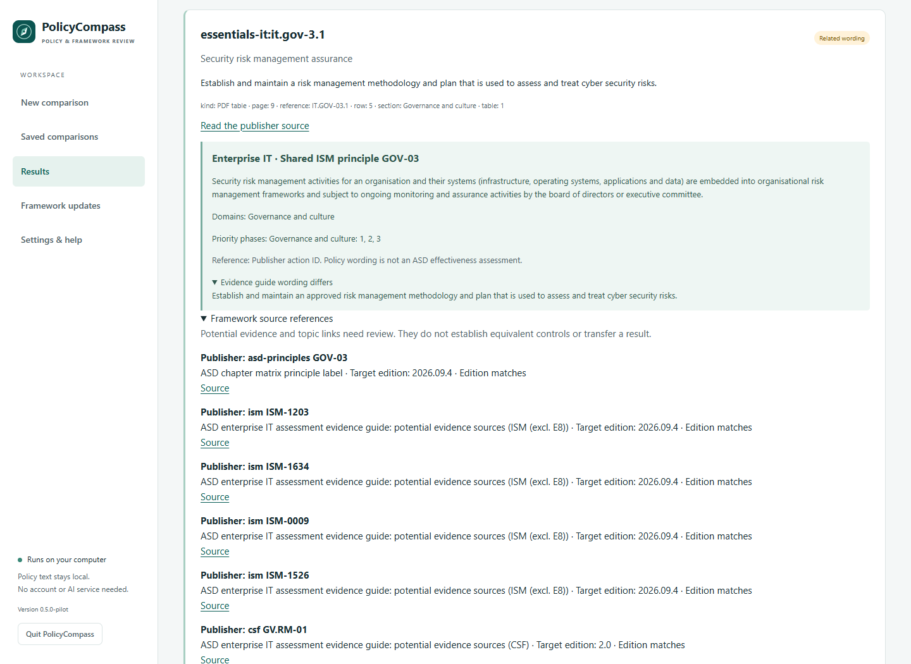
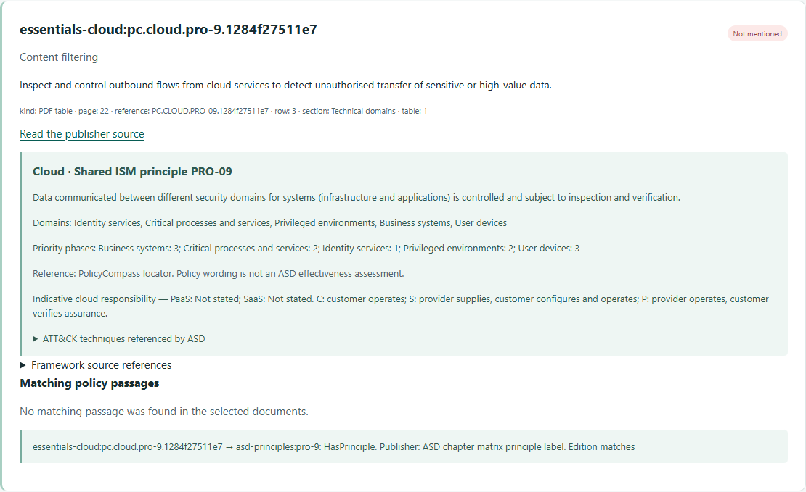

# Use ASD Essentials in PolicyCompass

PolicyCompass compares your policies with the actions in ASD Essentials. It shows
the relevant principle and where each action applies, then links the action to
passages in your documents.

## Choose the chapters that fit your environment

| Choice | Use it for | Actions in the October 2026 edition |
| --- | --- | ---: |
| **ASD Essentials — enterprise IT** (`essentials-it`) | Enterprise systems, including on-premises, hybrid and relevant infrastructure-as-a-service workloads | 58 |
| **ASD Essentials — cloud** (`essentials-cloud`) | Software-as-a-service and platform-as-a-service, including your tenant settings, identities, data and integrations | 78 |
| **ASD Essentials — OT** (`essentials-ot`) | Operational technology, industrial systems and the services needed to operate them safely | 61 |

You can select several chapters for one comparison. Use the responsibilities you
actually control to decide which chapters apply. ASD's
[chapter selection guide](https://www.cyber.gov.au/publication/which-chapter-should-i-start-with)
explains mixed environments. AI is considered within these environments, including
its governance, access and data risks.

**ASD cyber security principles** (`asd-principles`) is also available as a separate
choice. It contains all 49 principles from the ISM catalogue. The three Essentials
chapters use 41 of them and provide actions tailored to their environments.

## Download and compare

1. Open **Framework updates**, select the Essentials chapters you need and download
   them. The first update collects the 17 public PDFs, the enterprise IT assessment
   workbook and the ISM catalogue automatically.
2. Open **New comparison**, select your policy files and describe their scope.
3. Select your chapters and any other frameworks you want to compare, then choose
   **Compare and save**.
4. In **Requirements**, select an action to read its wording, principle, domains,
   source page and matching passages.

The downloaded collection is kept locally. Later comparisons work offline.
Framework updates affect new runs; an earlier run in **History** keeps the wording
and results used at the time. Older saved comparisons remain readable.

Command line example:

```powershell
python -m policycompass corpus update --framework essentials-it --framework essentials-cloud --framework ism --framework csf
python -m policycompass compare policies.zip --framework essentials-it --also-assess essentials-cloud --also-assess ism --also-assess csf --scope "Corporate and cloud policies" --assessment essentials.policycompass
python -m policycompass report essentials.policycompass --format html --output essentials-report.html
```

## Read actions in context

A **principle** describes the security outcome. An **action** describes what needs
to be done. A **domain** groups functions and assets with similar risks. One action
can apply to several domains, and a shared asset can belong to several domains.

Use the domain and priority-phase filters to focus the results list. These filters
change only the view: the comparison still includes every action in the selected
chapters. Priority phases describe ASD's recommended implementation order. They
are not maturity levels or ratings, and their order differs between chapters.
Governance and culture, and visibility and response, continue across all phases.

This example shows the action, its shared principle, a wording difference in the
evidence guide and the published framework references. It was captured from the
local browser app using the fictional demo policies.



Cloud actions also show ASD's indicative division of responsibility:

| Marker | Meaning |
| --- | --- |
| **C** | The customer implements and operates the control. |
| **S** | The provider supplies the capability; the customer enables, configures and operates it. |
| **P** | The provider operates the control; the customer checks the supporting assurance. |
| **Not stated** | The source leaves the marker blank. |

Check these against your service, contract and configuration. A provider's feature
list does not establish that your tenant uses a feature effectively.

The outbound-flow action below illustrates a blank publisher responsibility
marker. **Not stated** is retained rather than inferred from neighbouring rows.



## Follow framework references

The **Framework source references** distinguish published references from
suggested topic links. The enterprise IT evidence guide identifies controls in
ISM, Essential Eight, NIST CSF, SP 800-171r3 and AESCSF that may provide supporting
evidence. These references do not prescribe equivalent controls. Cloud and OT
actions keep their own context instead of inheriting the enterprise IT links.

Select the other framework in the same comparison to inspect available target
requirements. A reference shows when its framework was not selected, its edition
differs, or its identifier is absent. SP 800-171r3 references remain available as
external source references. Published CSF links can also connect to SP 800-53.

Select **ASD cyber security principles** to see PolicyCompass's suggested links
to WA CSP, PSPF and ASD mitigation strategies. These identify related topics for a
reviewer to examine; chapter actions do not inherit them. The reviewed set contains
94 candidates: 47 for WA CSP, 28 for PSPF and 19 for the 2017 ASD strategies.
A link never carries a match
from one requirement to another. Each framework is compared with your policies
independently.

## What the results establish

**Mentioned**, **Related wording**, **Not mentioned** and **Unable to check** describe
what the app found in your documents. They are not ASD effectiveness ratings.
Reading a policy cannot establish whether a control operates consistently across
the assets in scope. ASD's assessment process also requires current evidence,
coverage checks and assessor judgement.

Existing Essential Eight work can support an Essentials review, but its maturity
levels do not convert into Essentials ratings. Keep meeting current regulatory
obligations while checking the relevant authority's transition arrangements.

See [source notes](ESSENTIALS-SOURCES.md) for the publication inventory, wording
differences and review coverage, [integration checks](ESSENTIALS-VALIDATION.md) for
validation results, or [how matching works](MATCHING.md) for the limits of document
comparison.
